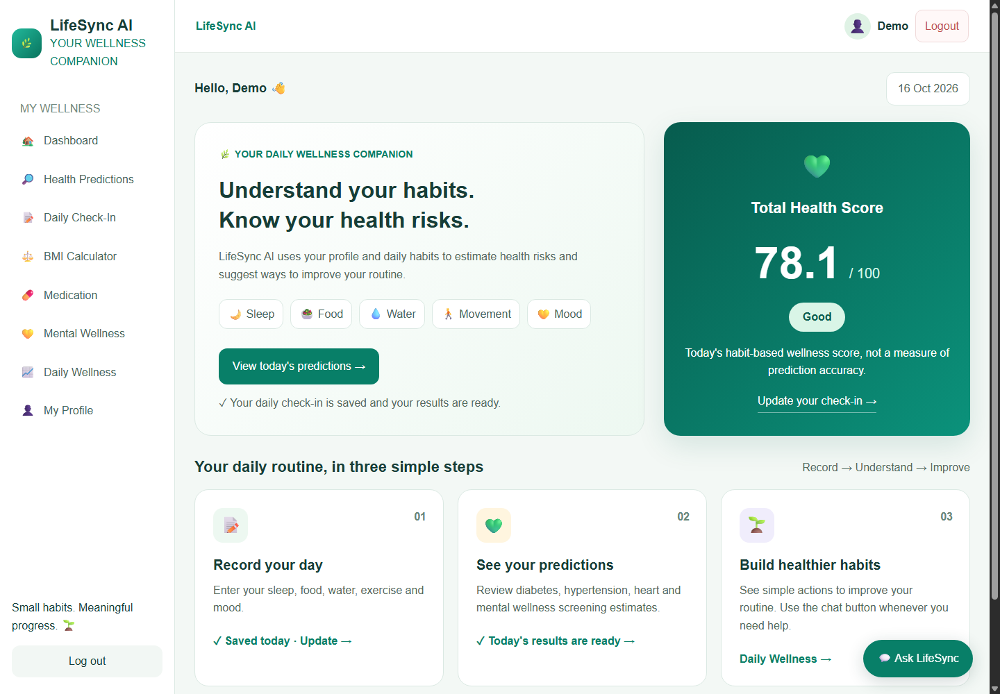
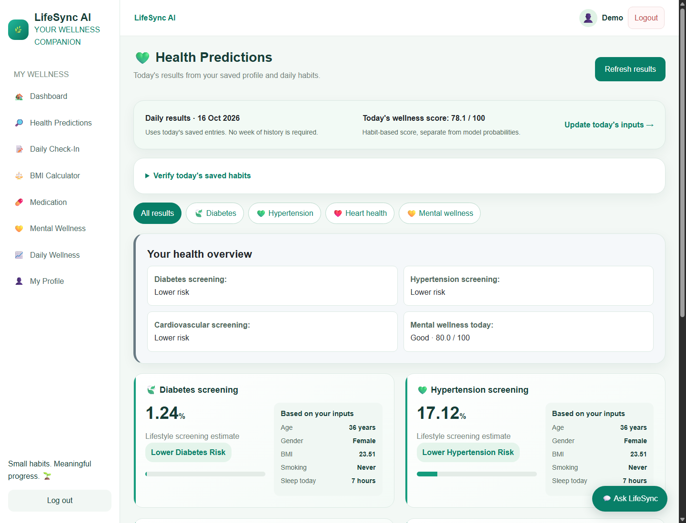

# LifeSync AI

**Lifestyle tracking, health risk screening, and daily mental wellness in one dashboard.**

LifeSync AI is a Django project that helps users record daily habits, review
model-based screening estimates, and follow their wellness progress. It is
intended for academic demonstration and lifestyle awareness.



## Features

- Account registration, login, logout, and personal health profiles.
- Compact daily check-in for sleep, water, exercise, meals, mood, stress,
  energy, and screen time.
- Plain numeric entry boxes without spinner arrows or wheel-based value changes.
  Measurements accept whole and decimal values; exercise hours accept fractions
  such as `1.5`. Whole-number counts and 1–5 ratings keep their validation rules.
- Diabetes, hypertension, cardiovascular, and depression-related screening.
- An eight-question mental wellness score that updates after assessment edits.
- BMI calculation and history, medication tracking, and interactive daily charts.
- Floating wellness chat with local guidance and optional local Ollama support.
- Responsive layouts, result filters, keyboard focus indicators, and clear empty states.

## Technology

| Area | Tools |
| --- | --- |
| Backend | Python 3.13, Django, SQLite |
| Machine learning | scikit-learn pipelines, pandas, NumPy, joblib |
| Training experiments | XGBoost, imbalanced-learn |
| Interface | Django templates, CSS, JavaScript, Bootstrap, Chart.js |
| Verification | Django tests, saved-model audit, GitHub Actions |

Exact environment versions are recorded in [requirements.txt](requirements.txt).
Bootstrap, icon fonts, and Chart.js are bundled under `static/vendor/` with
their licenses. The interface and charts work without CDN access after setup.
An internet connection is required only for installing Python dependencies or
explicitly refreshing vendored libraries.

## Quick start on Windows

Open the folder containing `manage.py`, not the outer parent folder.

With Python 3.13 installed, use the checked Windows launcher:

```powershell
.\run_windows.bat
```

It checks the project environment, runs setup when the environment or required
packages are missing, exercises all four models, applies existing migrations,
and starts Django. Setup can repair a copied environment in place without
deleting user records. Keep the terminal open while using the application.

For manual setup instead:

```powershell
python --version
python -m venv venv
.\venv\Scripts\python.exe -m pip install --upgrade pip
.\venv\Scripts\python.exe -m pip install -r requirements.txt
.\venv\Scripts\python.exe manage.py migrate
.\venv\Scripts\python.exe manage.py check
.\venv\Scripts\python.exe manage.py runserver
```

Open **http://127.0.0.1:8000/**, register a new account, complete your profile,
and save today's check-in. Predictions use your own saved data. No demo
credentials or existing user database are included.

For Django administration, create your own account:

```powershell
.\venv\Scripts\python.exe manage.py createsuperuser
```

Then open **http://127.0.0.1:8000/admin/**. Do not enter terminal commands at
the `Username:` prompt; enter a new username only.

On Linux/macOS, create the environment with `python3 -m venv venv` and use
`venv/bin/python` instead of `venv\Scripts\python.exe`.

## VS Code

1. Open this project folder, the one containing `manage.py` and `.vscode`.
2. Install the recommended Python and Python Debugger extensions.
3. Create the environment using the commands above, then run **Python: Select
   Interpreter** from the Command Palette and select this project's environment.
4. Press **F5** and choose **LifeSync: Django server** to debug the application.
5. Use **Terminal > Run Task** for project checks, tests, or model auditing.

The bundled task/interpreter paths target Windows. On Linux/macOS, select the
correct interpreter and use the terminal commands below. Virtual environments
are machine-specific and must not be copied from another computer.

## Prediction behavior

**Results work from the first saved daily check-in. No week of data is required.**
The prediction page shows the input date, today's wellness score, and an
expandable view of saved habits so changes can be verified. All four models use
one current profile/check-in snapshot for that request. Daily Wellness displays
today's values in a single-day bar chart; past entries remain in history.
Editing an older entry does not change today's
model estimates. A new day requires a new check-in rather than reusing yesterday.

The active models are `lifestyle_v10`. The four small model artifacts and their
metadata are included in this repository; retraining is not required to run it.

| Screening | Inputs |
| --- | --- |
| Diabetes | Age, gender category, BMI, smoking status, today's sleep |
| Hypertension | Age, gender category, BMI, smoking status, today's sleep |
| Cardiovascular | Age, gender category, BMI, smoking status |
| Depression-related lifestyle risk | Age, gender category, BMI, smoking status, today's sleep |

Models are restricted to adults aged 18 and above. Missing required inputs
keep a prediction unavailable. Updating sleep may change three estimates;
cardiovascular output remains unchanged unless a profile input changes.
Percentages can change without crossing the classification cutoff.
These are recalculations from current inputs, not validated day-ahead forecasts
of disease onset. Unchanged model inputs produce the same estimate; no random
changes are added to make the dashboard appear reactive.

**Mental wellness is shown separately:** the daily score uses eight assessment
answers. Higher mood, energy, motivation, concentration, and social wellbeing
raise it; higher stress, anxiety, and workload lower it. The score is not a
probability or a measure of model accuracy. Assessment edits update that score,
not the profile-and-sleep risk estimate.

Water, food, exercise, screen time, and daily mood support lifestyle tracking
and scoring; they are not invented model inputs. Screen time is not substituted
for sitting time and daily exercise is not multiplied into a guessed weekly total.



## Verified model performance

| Screening | Test records | Accuracy | Positive recall | Positive precision |
| --- | ---: | ---: | ---: | ---: |
| Diabetes | 1,576 | 77.0% | 48.8% | 29.4% |
| Hypertension | 1,241 | 73.1% | 82.4% | 73.1% |
| Cardiovascular | 1,208 | 81.5% | 47.1% | 34.0% |
| Depression-related screening | 1,091 | 74.6% | 50.3% | 26.3% |

**Unweighted mean accuracy: 76.5%.** This averages four separate tasks; it is
not a single validated accuracy for the whole application.

Training uses three-fold stratified out-of-fold predictions within the training
partition to choose the model and threshold. Preprocessing fits inside folds.
The test partition is separate from selection in that training run, but has
been evaluated in earlier experiments. These are internal evaluation results,
not independent external or clinical validation. Models can miss positive cases
and generate false positives. They do not diagnose disease or guarantee an
individual result, and their percentages are not clinically calibrated.

Details: [training report](ml/evaluation/RETRAINING_V10_RESULTS.md),
[verified metrics](ml/evaluation/verified_lifestyle_v10_metrics.json), and
[model documentation](ml/evaluation/LIFESTYLE_MODELS.md).

## Tests and reproducibility

From an activated environment, or using its Python executable:

```powershell
python manage.py check
python manage.py check_models
python manage.py makemigrations --check --dry-run
python manage.py test --noinput
python ml/evaluation/audit_saved_models.py --version lifestyle_v10
```

The latest application suite passed **168 tests**. Tests verify
registration, authorization, daily saves and edits, input mapping, actual model
outputs, score updates, missing inputs, and page workflows. They do not prove
clinical accuracy. The included GitHub Actions workflow runs checks, tests,
and a model audit on pushes and pull requests. Check the repository's Actions
tab for remote run results; local verification does not assert a remote CI status.

To repeat the latest training experiment:

```powershell
python -m ml.training.train_lifestyle_models_v10
```

Four reduced survey datasets are included for this experiment and its audit.
Large original survey files, historical model binaries, and optional BRFSS
experiments are excluded. Older training scripts may require those original
local inputs. See [data notes](ml/data/README.md).

## Project structure

```text
accounts/          Authentication and health profiles
dashboard/        Dashboard pages and workflow tests
lifestyle/         Check-ins, BMI, and wellness scoring
mental_health/     Eight-question assessment and history
notifications/     Medication tracking
predictions/       Prediction records, presentation, and tests
recommendations/   Daily actions and wellness chat
ml/                Active models, metadata, training, and evaluations
templates/         Django page templates
static/            CSS and JavaScript
docs/images/       Synthetic demonstration screenshots
.vscode/           Windows run, debug, and task configuration
.github/workflows/ Automated project checks
```

## Configuration and privacy

[.env.example](.env.example) documents supported environment variables. Django
reads operating-system environment variables; this file is not loaded automatically.
Local development runs with development-only defaults. Set real secrets and
production settings through the environment before deployment.

The Git ignore rules exclude the user database, uploaded files, backups, logs,
virtual environments, browser profiles, and large historical models. Existing
local records are preserved. Screenshots use synthetic demonstration data.
Only load trusted joblib model artifacts.

## Startup checks and saved-data updates

Check the runtime before a demonstration without starting the server:

```powershell
.\run_windows.bat --check
```

The check uses the project interpreter and identifies missing packages, missing
model artifacts, and invalid model outputs before showing a prediction page.
To reinstall dependencies explicitly, use that same project interpreter:

```powershell
.\venv\Scripts\python.exe -m pip install -r requirements.txt
.\venv\Scripts\python.exe manage.py check_models
```

New accounts must complete their profile and today's check-in before a model
estimate is available. This is an intentional missing-data state. The page
provides links to complete those details.

Saving a mental assessment returns to predictions with the saved score in a
confirmation message. Today's overview and assessment card read the saved
answers. The separate profile-and-sleep estimate is expandable and does not
change merely because questionnaire answers change. Opposing answer edits can
produce the same weighted score; no artificial probability changes are added.

Styles, icons, and charts are served locally. If an older cached page remains
after updating the code, refresh with **Ctrl+F5**. Production hosting must serve
the collected static files; the Windows launcher uses Django's development server.

## Project documentation

| Document | Purpose |
| --- | --- |
| [Abstract](ABSTRACT.md) | Submission-ready project description and measured results |
| [Demonstration guide](EVALUATION_GUIDE.md) | Account-to-prediction workflow and expected update behavior |
| [Review evidence](PROJECT_CHECK_REPORT.md) | Test results, browser checks, and known evaluation limits |
| [GitHub guide](GITHUB_UPLOAD.md) | Repository setup, safe updates, and clean-checkout instructions |
| [Frontend dependencies](static/vendor/README.md) | Pinned local assets, licenses, and integrity manifest |

The project is published at [Annarosejoshi/LifeSyncAIPro](https://github.com/Annarosejoshi/LifeSyncAIPro).
For future changes in this checkout, review the diff, commit, and push to the
existing `origin` remote; do not add a placeholder remote URL again.

A software license has not yet been selected. Choose an appropriate license
before inviting reuse; dataset/source terms remain separate from code licensing.
